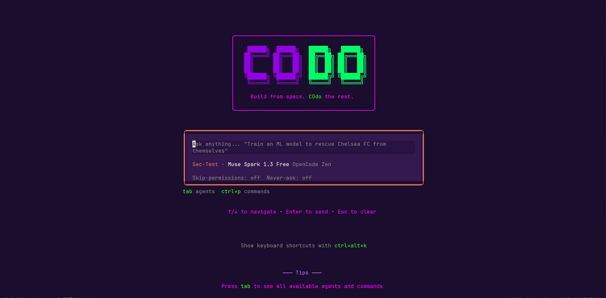

<div align="center">


# \>_ COdo

**The all-loop terminal AI coding agent.**

**Plan it.** **Build it.** **Secure it.** **Ship it.**

[Website](https://codo-ai.vercel.app/) · [Documentation](https://codo-ai.vercel.app/docs) · [GitHub](https://github.com/Mosalah4351/COdo) · [Report Issue](https://github.com/Mosalah4351/COdo/issues)

`npm install -g codo-ai`

[](LICENSE)
[](#)
[](https://www.npmjs.com/package/codo-ai)



</div>

---

## What is COdo?

COdo is a **terminal-native, spec-driven AI coding agent** — an independent
project that builds on portions of [OpenCode](https://github.com/anomalyco/opencode)
(core engine + TUI, MIT-attributed) and closes the full working loop:

**plan** the project with a workflow engine → **build** it with a multi-agent
compose engine → **secure** it with the Sec-Test engine → **ship** it with a
business suite (docs, decks, PDFs, research, video) and a compliance-first
scraper. See [NOTICES.md](NOTICES.md) and
[docs/not-a-fork/](docs/not-a-fork/VISIBLE-DIFFERENCES.md) for exactly what
COdo adds and what it inherits.

No browser tab. No separate app. No context-switching. Just you, your terminal,
and an AI that knows what phase of the project you're in.

```
$ npm install -g codo-ai
$ cd my-project
$ codo
```

Most AI coding tools give you a place to type questions. COdo gives you a
**loop** — pick a workflow, compose the build, gate the outcome, verify the
security posture, and ship the artifacts. Code is only half the job; COdo
handles the other half in the same terminal.

## Why COdo?

One-shot chat assistants answer one question and stop. COdo covers all four
jobs, in one place:

| | Chat assistants | **COdo** |
|---|---|---|
| **Plan** | no persistent plan | workflow engines with milestone state that survive context resets |
| **Build** | one agent, one context | multi-agent compose — parallel waves, specialist agents |
| **Secure** | after the fact, if at all | Sec-Test — evidence-first findings before the code exists |
| **Ship** | nothing to help | business suite + compliance-first scraper — research to rendered PDF, no exit |

## Highlights

### 1 · Plan — Workflow Engines

Switch methodology per project scale, not per religion:

- `/workflow gsd` — autonomous milestone planning, persistent `.planning/` state, survives context resets
- `/workflow gstack` — Garry Tan's 23-role virtual engineering team
- `/workflow speckit` — spec-first pipeline (SDD)
- `/workflow vibemode` — pure flow, zero overhead

### 2 · Build — Multi-Agent Compose

Complex tasks decompose into DAGs routed to specialist agents executing in
parallel waves:

```
/compose "Build auth service with JWT, rate limiting & Sec-Test"
  [A] Planner          → spec + task breakdown     ┐ parallel
  [B] Builder          → implementation            ├ wave
  [C] AppSec Engineer  → real-time SAST audit      │
  [D] Quality Engineer → mutation tests            ┘
```

**Goal Judge** closes the loop — declare outcomes, not tasks; an independent
judge model verifies stop-conditions, so the builder never self-approves:

```
/goal "All tests pass with >80% coverage and zero HIGH/CVEs"
```

### 3 · Secure — Sec-Test Orchestrator

Six specialist personas guarding the full lifecycle. One dispatcher routes
your request; each persona does exactly one job and does it ruthlessly:

| Persona | Role |
|---|---|
| **Security Architect** | Pre-code STRIDE/DREAD threat modeling (OWASP ASVS mapped) |
| **AppSec Engineer** | Real-time SAST on diffs — OWASP Top 10:2025 / CWE Top 25, secrets, CVEs |
| **DevSecOps Engineer** | Pipeline hardening (NIST SSDF), SBOM (CycloneDX/SPDX), SLSA + Sigstore |
| **Penetration Tester** | Scope-gated live probing (PTES/WSTG) — refuses targets outside `.codo/security-scope.json` |
| **Quality Engineer** | Adversarial tests verified by mutation kill-rate |
| **Security Engineer** | Audits the agent itself; posture drift tracking |

```bash
$ /sec-test "Audit git diff for SQL injection and hardcoded secrets"
[1] Raw string concatenation in query builder
[2] Hardcoded fallback JWT secret ("dev-secret-key-12345")
→ Parameterized query fix applied · secret moved to env with startup validation
```

Every finding gets an ID, a severity, evidence, and a remediation path — stored
durably, never lost in markdown notes.

### 4 · Ship — Business Suite & Scraper

Yes, your coding agent does expense reports too. Production-grade office
tooling as skills: `xlsx-official`, `docx-official`, `pptx-official`,
`pdf-official`, `deep-research`, `super-research`, `research-paper-writing`,
`html-to-video-pipeline`, `sales`. Research it, spreadsheet it, deck it, ship
the PDF — without leaving the terminal.

And when the job needs real data: `/scraper <url> <what to extract>` —
robots.txt honored, ToS checked, crawl-delays enforced, escalation ladder from
static fetch to authenticated sessions. It asks permission before it knocks;
most scrapers just knock.

## Skills — the agent's toolbox

Skills are what keep COdo focused: heavy, well-defined jobs become one command
each. A few of the built-ins:

| Category | Skills |
|---|---|
| **Research** | `deep-research` · `super-research` · `arxiv` · `learn-everything` |
| **Documents** | `docx-official` · `xlsx-official` · `pptx-official` · `pdf-official` |
| **Design & frontend** | `frontend-design` · `design-blueprint` · `product-design` |
| **Data, papers & code** | `data-analytics` · `research-paper-writing` · `modern-python-toolchain` · `skill-creator` |
| **Media & sales** | `html-to-video-pipeline` · `sales` |

Run `/skills` to see what's loaded; install more or write your own with
`skill-creator`.

## Best practices — getting good runs out of COdo

1. **Match the workflow to the scale.** Quick fix → `vibemode`. Milestone-sized
   project → `gsd` (plans phases, keeps durable state across context resets).
   Spec-first team → `speckit`.
2. **Plan before build.** Run the plan phase first — the plan is what anchors
   the agent when context resets, and compose DAGs are built from it.
3. **Declare outcomes with `/goal`.** The independent judge verifies
   stop-conditions; the builder never self-approves.
4. **Make Sec-Test a gate, not an afterthought.** Audit the diff before every
   commit; findings persist with IDs — treat them as tasks, not warnings.
5. **Compose for parallel work.** Big features decompose into DAGs; run the
   security architect in wave 1, not wave 3.
6. **One concern, one session.** The multi-session model lets parallel agents
   work on the same project — keep them scoped.
7. **Pick the model per job.** Routine edits on cheap models, planning and
   security review on frontier — `/connect` logs in with existing
   subscriptions.

## Use any model

75+ LLM providers through [Models.dev](https://models.dev), including local
models. Prefer your existing subscriptions? Log in with GitHub to use your
Copilot account, or with OpenAI for ChatGPT Plus/Pro. New to providers? Run
`/connect` and try [COdo Zen](https://codo-ai.vercel.app/docs/zen) — models
tested and verified by the COdo team.

## Everywhere you work

- **Native TUI** — responsive, themeable terminal UI (35+ themes).
- **Desktop app & VS Code extension** — same agent, your preferred surface.
- **LSP enabled** — automatically loads the right language servers for the LLM.
- **Multi-session** — parallel agents on the same project.
- **Shareable links** — send any session for reference or debugging.

## Install

```bash
# Recommended
npm install -g codo-ai

# One-time run
npx codo-ai
```

Requirements: Node 18+ or Bun · macOS / Linux / Windows · any provider API key
(Anthropic, OpenAI, NVIDIA free tier, Google, or OpenAI-compatible).

> Migrating from `@codo-ai/cli`? That package is deprecated — `codo-ai` replaces it.

## Documentation

Full developer docs — every persona, skill, workflow, permission mode, and best
practice — live at **[codo-ai.vercel.app](https://codo-ai.vercel.app/)**.

## Contributing

PRs welcome on [GitHub](https://github.com/Mosalah4351/COdo). Default branch:
`main`. Conventional commits (`feat/fix/docs/chore/refactor/test`).

## License

MIT © [Mohamed Salah](https://www.linkedin.com/in/mohamed-salah-59bb41300/)

COdo is an independent project. Its core engine and TUI portions are derived
from [OpenCode](https://github.com/anomalyco/opencode) (MIT). Upstream copyright
notice retained in [NOTICES.md](NOTICES.md).

## Contributors

- **COdo agent** — AI contributor (session title generation, Muse prompt restore, release tooling). Commits carry a `Co-Authored-By: COdo agent` trailer.

## Community

- **Issues** — <https://github.com/Mosalah4351/COdo/issues>
- **Discussions** — <https://github.com/Mosalah4351/COdo/discussions>
- **Docs** — <https://codo-ai.vercel.app/docs>

If you find a vulnerability in COdo, please do **not** open a public issue — email
`mosalah4351@gmail.com` with a proof-of-concept.
